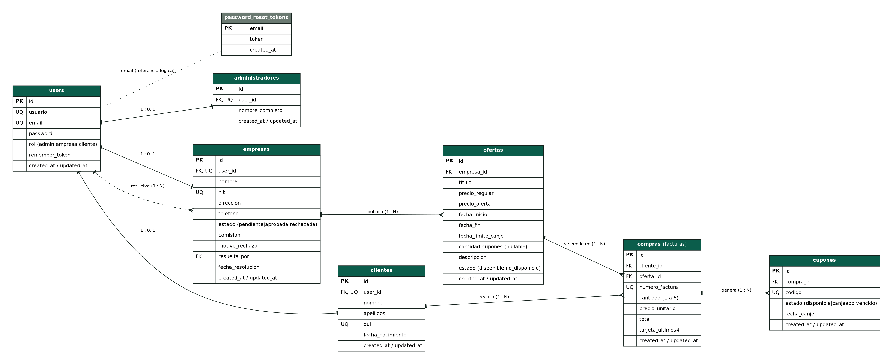

# La Cuponera SV: modelo relacional y descripción de tablas



**Motor:** MySQL (InnoDB, `utf8mb4`). Todas las tablas incluyen `created_at` y `updated_at` (los pone Laravel automáticamente).
**Convención:** `PK` llave primaria · `FK` llave foránea · `UQ` valor único.

## Decisiones de diseño

- **`users` es la tabla central de autenticación.** Administradores, empresas y clientes inician sesión desde ahí (campo `rol`). Los datos propios de cada tipo viven en su tabla (`administradores`, `empresas`, `clientes`), unidas por una relación 1 a 1 mediante `user_id`. Así el login y la recuperación de contraseña son una sola lógica para los tres tipos de usuario.
- **Una compra es una factura.** `compras` guarda la factura (cliente, oferta, cantidad, total) y `cupones` guarda un registro por cada cupón comprado, cada uno con su **código único**.
- **La comisión se guarda en `empresas.comision`.** La fija el administrador al aprobar la solicitud, así que los reportes de ganancias se calculan sin tablas adicionales.
- **Datos de tarjeta:** solo se guardan los últimos 4 dígitos (`tarjeta_ultimos4`). El número completo y el CVV se validan y se descartan, porque la compra es simulada.

---

## 1. `users`
Cuentas de acceso de los tres tipos de usuario.

| Campo | Tipo | Restricciones | Descripción |
|---|---|---|---|
| id | BIGINT UNSIGNED | PK, autoincremental | Identificador de la cuenta |
| usuario | VARCHAR(30) | UQ, NOT NULL | Nombre de usuario para iniciar sesión |
| email | VARCHAR(255) | UQ, NOT NULL | Correo electrónico (también sirve para recuperar la contraseña) |
| password | VARCHAR(255) | NOT NULL | Contraseña cifrada con bcrypt |
| rol | ENUM('admin','empresa','cliente') | NOT NULL, índice | Tipo de usuario; decide a qué paneles puede entrar |
| remember_token | VARCHAR(100) | NULL | Token de "mantener sesión iniciada" |
| created_at, updated_at | TIMESTAMP | NULL | Fechas de creación y modificación |

## 2. `password_reset_tokens`
Tokens temporales para recuperar la contraseña (vencen a los 60 minutos).

| Campo | Tipo | Restricciones | Descripción |
|---|---|---|---|
| email | VARCHAR(255) | PK | Correo de la cuenta (referencia lógica a `users.email`) |
| token | VARCHAR(255) | NOT NULL | Token cifrado que viaja en el enlace del correo |
| created_at | TIMESTAMP | NULL | Momento en que se generó; sirve para calcular el vencimiento |

## 3. `sessions`
Tabla técnica de Laravel para guardar sesiones en base de datos. No aparece en el diagrama; con la configuración incluida (`SESSION_DRIVER=file`) no se utiliza.

| Campo | Tipo | Restricciones | Descripción |
|---|---|---|---|
| id | VARCHAR(255) | PK | Identificador de la sesión |
| user_id | BIGINT UNSIGNED | NULL, índice | Usuario autenticado en esa sesión |
| ip_address | VARCHAR(45) | NULL | IP del visitante |
| user_agent | TEXT | NULL | Navegador del visitante |
| payload | LONGTEXT | NOT NULL | Datos de la sesión |
| last_activity | INT | índice | Última actividad (timestamp) |

## 4. `administradores`
Datos de los administradores del sistema. Relación 1 a 1 con `users`.

| Campo | Tipo | Restricciones | Descripción |
|---|---|---|---|
| id | BIGINT UNSIGNED | PK | Identificador |
| user_id | BIGINT UNSIGNED | FK → users.id, UQ, ON DELETE CASCADE | Cuenta de acceso del administrador |
| nombre_completo | VARCHAR(150) | NOT NULL | Nombre de la persona |

## 5. `empresas`
Empresas ofertantes. Nacen con estado `pendiente` y un administrador las aprueba o rechaza.

| Campo | Tipo | Restricciones | Descripción |
|---|---|---|---|
| id | BIGINT UNSIGNED | PK | Identificador |
| user_id | BIGINT UNSIGNED | FK → users.id, UQ, ON DELETE CASCADE | Cuenta de acceso de la empresa (aquí están usuario, correo y contraseña) |
| nombre | VARCHAR(150) | NOT NULL | Nombre de la empresa |
| nit | VARCHAR(17) | UQ, NOT NULL | NIT con formato `0000-000000-000-0` |
| direccion | VARCHAR(255) | NOT NULL | Dirección |
| telefono | VARCHAR(9) | NOT NULL | Teléfono con formato `0000-0000` |
| estado | ENUM('pendiente','aprobada','rechazada') | NOT NULL, default `pendiente` | Resultado de la revisión del administrador |
| comision | DECIMAL(5,2) | NULL | % que La Cuponera cobra por cada cupón vendido; se fija al aprobar |
| motivo_rechazo | VARCHAR(255) | NULL | Razón del rechazo (solo si fue rechazada) |
| resuelta_por | BIGINT UNSIGNED | FK → users.id, NULL, ON DELETE SET NULL | Administrador que resolvió la solicitud |
| fecha_resolucion | TIMESTAMP | NULL | Cuándo se aprobó o rechazó |

## 6. `clientes`
Compradores de cupones. Relación 1 a 1 con `users`.

| Campo | Tipo | Restricciones | Descripción |
|---|---|---|---|
| id | BIGINT UNSIGNED | PK | Identificador |
| user_id | BIGINT UNSIGNED | FK → users.id, UQ, ON DELETE CASCADE | Cuenta de acceso del cliente |
| nombre | VARCHAR(100) | NOT NULL | Nombre completo |
| apellidos | VARCHAR(100) | NOT NULL | Apellidos |
| dui | VARCHAR(10) | UQ, NOT NULL | DUI con formato `00000000-0` |
| fecha_nacimiento | DATE | NOT NULL | Se valida que el cliente tenga al menos 18 años |

## 7. `ofertas`
Cupones que publican las empresas aprobadas.

| Campo | Tipo | Restricciones | Descripción |
|---|---|---|---|
| id | BIGINT UNSIGNED | PK | Identificador |
| empresa_id | BIGINT UNSIGNED | FK → empresas.id, ON DELETE CASCADE | Empresa que publica la oferta |
| titulo | VARCHAR(150) | NOT NULL | Título de la oferta |
| precio_regular | DECIMAL(10,2) | NOT NULL | Precio normal del producto o servicio |
| precio_oferta | DECIMAL(10,2) | NOT NULL | Precio con descuento (lo que paga el cliente) |
| fecha_inicio | DATE | NOT NULL | Desde cuándo se vende el cupón |
| fecha_fin | DATE | NOT NULL | Hasta cuándo se vende el cupón |
| fecha_limite_canje | DATE | NOT NULL | Última fecha para canjear el cupón en la empresa |
| cantidad_cupones | INT UNSIGNED | NULL | Máximo de cupones a vender; si es `NULL`, no hay límite |
| descripcion | TEXT | NOT NULL | Detalle de la oferta |
| estado | ENUM('disponible','no_disponible') | NOT NULL, default `disponible`, índice | Las `no_disponible` no se muestran al público |

## 8. `compras`
Una fila por compra; funciona como la **factura** del cliente. Un cliente puede comprar de 1 a 5 cupones de la misma oferta (en total).

| Campo | Tipo | Restricciones | Descripción |
|---|---|---|---|
| id | BIGINT UNSIGNED | PK | Identificador |
| cliente_id | BIGINT UNSIGNED | FK → clientes.id, ON DELETE CASCADE | Cliente que compra |
| oferta_id | BIGINT UNSIGNED | FK → ofertas.id, ON DELETE RESTRICT | Oferta comprada (no se puede borrar si ya tiene ventas) |
| numero_factura | VARCHAR(20) | UQ, NOT NULL | Número de la factura |
| cantidad | TINYINT UNSIGNED | NOT NULL | Cupones comprados en esta factura |
| precio_unitario | DECIMAL(10,2) | NOT NULL | Precio de oferta al momento de la compra |
| total | DECIMAL(10,2) | NOT NULL | `cantidad × precio_unitario` |
| tarjeta_ultimos4 | CHAR(4) | NOT NULL | Últimos 4 dígitos de la tarjeta (referencia) |

## 9. `cupones`
Un registro por cada cupón individual comprado. El código único es lo que valida su legitimidad.

| Campo | Tipo | Restricciones | Descripción |
|---|---|---|---|
| id | BIGINT UNSIGNED | PK | Identificador |
| compra_id | BIGINT UNSIGNED | FK → compras.id, ON DELETE CASCADE | Factura a la que pertenece |
| codigo | VARCHAR(20) | UQ, NOT NULL | Código único del cupón |
| estado | ENUM('disponible','canjeado','vencido') | NOT NULL, default `disponible` | Situación del cupón |
| fecha_canje | TIMESTAMP | NULL | Cuándo se canjeó |

---

## Relaciones

| Relación | Cardinalidad | Llave |
|---|---|---|
| users → administradores | 1 a 0..1 | administradores.user_id |
| users → empresas | 1 a 0..1 | empresas.user_id |
| users → clientes | 1 a 0..1 | clientes.user_id |
| users → empresas (quién resolvió) | 1 a N | empresas.resuelta_por |
| empresas → ofertas | 1 a N | ofertas.empresa_id |
| clientes → compras | 1 a N | compras.cliente_id |
| ofertas → compras | 1 a N | compras.oferta_id |
| compras → cupones | 1 a N | cupones.compra_id |

## Cómo salen los reportes del administrador (fase final)

```sql
-- Cupones vendidos, ventas y ganancias por empresa
SELECT e.nombre,
       SUM(c.cantidad)                       AS cupones_vendidos,
       SUM(c.total)                          AS total_ventas,
       SUM(c.total * e.comision / 100)       AS ganancia_cuponera
FROM compras c
JOIN ofertas  o ON o.id = c.oferta_id
JOIN empresas e ON e.id = o.empresa_id
GROUP BY e.id, e.nombre;

-- Ganancia total de La Cuponera
SELECT SUM(c.total * e.comision / 100) AS ganancia_total
FROM compras c
JOIN ofertas  o ON o.id = c.oferta_id
JOIN empresas e ON e.id = o.empresa_id;
```

Regla de 5 cupones por oferta: `SELECT COALESCE(SUM(cantidad),0) FROM compras WHERE cliente_id = ? AND oferta_id = ?` debe ser menor o igual a 5 después de la compra.
